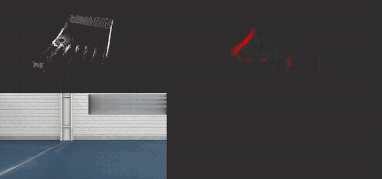
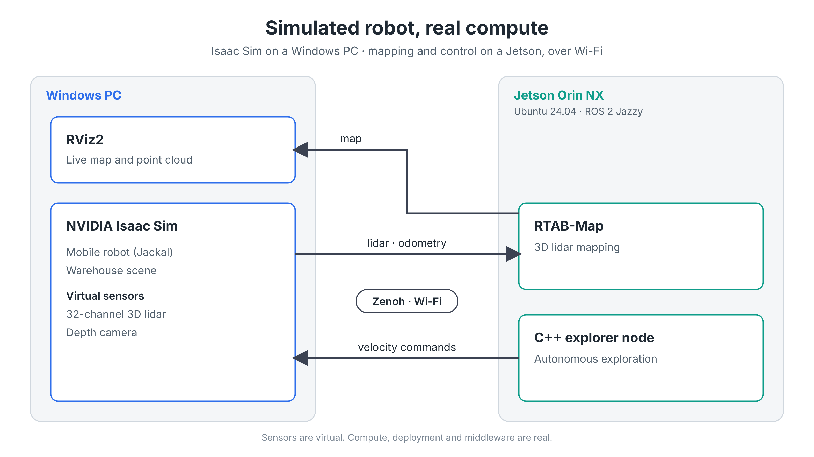

# Simulated robot, real compute

**Run on the final hardware as early as possible. Even before the robot exists.** 🤖

Isaac Sim runs on a Windows workstation. A Jetson Orin NX, connected over Wi-Fi with ROS 2 Jazzy, does the mapping.
The sensors are virtual. The compute, the deployment and the middleware are real.

## Architecture

- Cross-OS plumbing
- LiDAR or camera
- Bandwidth forces discipline

## The robot

The robot started from an incomplete USD model of a commercial mobile robot. I rebuilt the ROS 2 bridge and added
high-end virtual sensors (a depth camera and a 32-channel lidar) to make it run end to end.

## Next steps

1. Detect and recognize objects.
2. Remember them on the map.
3. Pick them up, maybe with an arm.

---

Questions about the setup? Message me on LinkedIn.

#ROS2 #IsaacSim #Jetson #Robotics #EdgeAI
